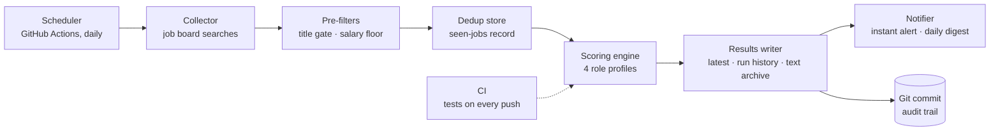

# Job Scraper — Automated Job Matching Pipeline

**Status:** Production (runs daily) · **Stack:** Python, GitHub Actions, pytest, Slack and Discord webhooks · **Role:** Product owner and architect. I scoped each change, directed AI coding tools (Claude Code) to build it, and reviewed every diff before merge.

> Source code is private. This page explains the design, decisions and lessons. All examples use made-up data.

## Problem
- Job searching across several role types meant hours of manual searching, with the same postings showing up again and again.
- Generic job alerts match on titles only, so they cannot tell a strong fit from a weak one.
- Any automated tool also had to stay honest: never rank a job highly because of skills the candidate does not actually have.

## Solution
A scheduled, serverless pipeline. Every day it pulls new postings, removes the ones it has already seen, scores each one against several role profiles, and sends alerts: an instant message for strong matches and a daily digest for the rest. Results are committed back to the repo, so every run can be audited and replayed later.

## Architecture

- **Single config file:** search terms, locations, keyword weights and thresholds all live in one place.
- **Scoring engine:** weighted keyword matching per role profile. Gap and level terms are recorded but never scored.
- **Run history:** every run is stamped with its config version, so any score can be traced to the rules that produced it.

## Key design decisions
| Decision | Alternatives considered | Why |
|---|---|---|
| Serverless on GitHub Actions | VPS, cloud functions | No server to maintain or secure, and the run history is free |
| Explainable keyword scoring | ML model, LLM scoring | Every score can be traced to the matched terms and replayed exactly |
| Record gap terms, never score them | Score everything | The tool must not reward skills the candidate does not have |
| Measure before every change | Change, then observe | Each change is first run read-only against archived jobs, with a before/after report |
| Risky sources off by default | Scrape every board | Sources that block automation or forbid it in their terms stay disabled |

## Security and data handling
- **Secrets management:** webhook URLs live only in GitHub Secrets. Local secrets are git-ignored.
- **PII boundary:** resumes and personal documents never enter the repo. The skills file the scraper reads is a filtered export with no employers, dates or contact details.
- **Change control:** no change merges without a build, tests and a reviewed diff. Running the pipeline locally is banned, so a test cannot send real alerts or overwrite data.
- **Least privilege:** the test workflow has no secrets and no write access.

## Testing and quality
- **Characterization tests** pin current behavior, including known bugs, labelled `KNOWN BUG`. A fix then shows up as a precise, reviewable change rather than a silent shift.
- **Regression replay:** archived jobs are re-scored and must reproduce their stored scores exactly.
- **CI:** the full suite runs in a clean environment on every push. No network access, no secrets.

## Code sample (illustrative, not production code)
```python
import re

def normalize(text: str) -> str:
    """Remove escape backslashes the job board leaves in its text (e.g. 'cross\\-functional')."""
    return re.sub(r"\\(?=[^\w\s])", "", text.lower())

def keyword_hits(text: str, weights: dict[str, int]) -> dict[str, int]:
    """Match whole words only, so 'ai' never matches inside 'maintain'."""
    text = normalize(text)
    hits = {}
    for term, weight in weights.items():
        if re.search(rf"(?<!\w){re.escape(term)}(?!\w)", text):
            hits[term] = weight
    return hits

def check_outage(stats: dict) -> None:
    """A run where every search came back empty is an outage, not a quiet day."""
    if stats["attempted"] > 0 and stats["empty"] == stats["attempted"]:
        raise RuntimeError("All searches returned zero results: source may be blocking")
```

## Incidents

**1. Silent failure: a total block looked like a quiet day**
- **Detection:** caught by manual review. Several daily digests showed zero results, but every run had passed.
- **Impact:** several days with no job coverage and no alert.
- **Root cause:** an empty response was treated as a normal result at every layer, from collector to pipeline to notifier to workflow.
- **Fix:** count the outcome of every search (returned, empty, failed). If every search comes back empty, raise a critical alert and post an outage notice instead of the usual digest.
- **Lesson:** "no data" and "no news" need different signals. Monitor the monitor.

**2. Scoring skills the candidate does not have**
- **Detection:** an audit of keyword lists against the verified skills inventory.
- **Impact:** some jobs were ranked higher because of skills listed as gaps.
- **Root cause:** keyword lists were maintained by hand and drifted from the verified skills record.
- **Fix:** gap and level terms are recorded but never scored, and a guard test fails if any of them reappears in a scoring list. The change was measured on archived jobs before release.
- **Lesson:** integrity rules belong in tests, not in memory.

**3. Escaped characters blocked every compound keyword**
- **Detection:** a scoring-spec review found terms with a hyphen or plus sign had never once matched.
- **Impact:** a whole class of keywords had silently scored zero since launch.
- **Root cause:** the job board's text contains escape backslashes (`cross\-functional`) that the matcher did not handle.
- **Fix:** clean the text before matching, pinned by tests.
- **Lesson:** check what real input looks like before trusting the match logic.

## Outcomes and next steps
- Daily matched leads with no manual searching, and no repeat alerts.
- Every score is reproducible and auditable from the run history.
- **Next:** make scores comparable across role profiles, and track per-query yield.

[← Back to the portfolio](../README.md)
