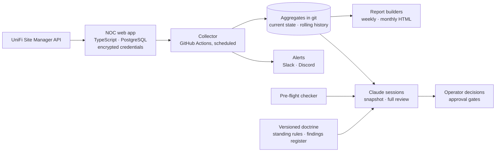

# NOC Monitoring Platform — Multi-Site Network Health for an MSP

**Status:** Production · **Stack:** TypeScript (React, Express), PostgreSQL, UniFi Site Manager API, GitHub Actions, Python report builders, Slack and Discord alerts, Claude with an MCP server · **Role:** Product owner and architect. I scoped each stage, directed AI coding tools (Replit Agent, Claude Code) to build it, ran the audits, and approved every production change.

> Built for my employer, an IT managed-service provider. Code and client data are private. This page covers the architecture and the operating discipline only; all examples are generic.

## Problem
- The MSP manages networks for dozens of client sites. Health checks meant opening each site's console one at a time.
- Slow problems like rising Wi-Fi retries, WAN instability or a site quietly going offline were noticed late, usually when the client called.
- AI analysis was attractive but risky: an AI reading live systems can act on stale data, guess, or change things it should not.

## Solution
Two systems working together:
- **The collector:** an unattended system that pulls health data for every site on a schedule.
- **The analyst:** Claude, in structured sessions, reading only what the collector wrote.

It is a closed loop. Every session starts with an automated pre-flight check, works from versioned rules, and ends by writing what the next session needs.

## Architecture

- **Aggregate before analysis:** scripts reduce raw telemetry to a compact per-site summary. The script does the arithmetic; Claude does the judgment.
- **Named commands:** snapshot (a quick check, no files), full review (fleet report), weekly and monthly reviews. Each has a defined input, output and cadence.
- **Source and age on every output:** each answer names the data file and its timestamp, so stale data is never presented as live.

## Key design decisions
| Decision | Alternatives considered | Why |
|---|---|---|
| Separate collector and analyst | Claude queries live systems | Analysis is reproducible, rate-limit free, and cannot change production |
| Versioned doctrine and standing rules | Instructions in chat history | Rules survive between sessions. Each rule records the failure that created it |
| Findings register: catalogue, don't auto-fix | Fix issues as found | Every fix gets a deliberate, approved decision instead of a drive-by change |
| Reconcile against the source of truth | Check records against themselves | Self-comparison hides drift. Get the true total first |
| Operator-held stage gates | Automatic progression | Nothing reaches production without a human decision |

## Security and data handling
- **Secrets management:** API keys live only in the CI secret store and are encrypted at rest in the app's database (AES-256-GCM). A standing rule bans secrets in any file or chat.
- **Least privilege for AI:** Claude reads committed aggregates only. Any contact with the production app is read-only questions, and every change needs explicit operator approval.
- **Privacy on screen:** a privacy mode masks IPs, MAC addresses and site identifiers by default.
- **Change control:** staged releases with stated pass criteria, dry runs before anything irreversible, and "verify by effect": a fix is not done until fresh data shows the problem is gone.
- **Data protection freeze:** a precise scope, a named authority and written lift conditions, applied to scheduled jobs as well as people.
- **Two environments, never confused:** an always-visible environment banner and a quick check before any change.

## Testing and quality
- **Pre-flight checker** runs before every session. It checks file versions, alarm states, active holds and data age.
- **Diagnostics toolkit:** reconciliation against production, frozen-data detection, API-error streak detection, and pointer and version checks.
- **Structured audit:** a full audit covering every script, workflow and app component, with every finding logged in a register and given a severity and disposition. Corrections are appended, never edited in place.

## Code sample (illustrative, not production code)
```python
from datetime import datetime, timezone

def classify(value: float, ok_below: float, warn_below: float) -> str:
    """Threshold bands come from config, never hard-coded in reports."""
    if value is None:
        return "NO DATA"          # never render a missing value as healthy
    if value < ok_below:
        return "OK"
    return "WARNING" if value < warn_below else "CRITICAL"

def preflight_age(run_at_iso: str, max_hours: float) -> str:
    """Every session states the data's age before any analysis."""
    run_at = datetime.fromisoformat(run_at_iso.replace("Z", "+00:00"))
    hours = (datetime.now(timezone.utc) - run_at).total_seconds() / 3600
    status = "CURRENT" if hours <= max_hours else "STALE: say so, do not present as live"
    return f"Data from {run_at:%Y-%m-%d %H:%M} UTC ({hours:.1f} h old): {status}"
```

## Incidents

**1. A scheduled run failed, and nobody was told**
- **Detection:** a manual review found a collection run had failed with no notification.
- **Impact:** a gap in monitoring that could have gone unnoticed.
- **Root cause:** the alert step only ran when collection succeeded, so a failure produced silence.
- **Fix:** a self-contained failure alert that fires on any failed step. It runs independently of the normal notification code, so it still works if that code breaks.
- **Lesson:** a silent monitor is the failure it exists to prevent.

**2. The repository's ignore file had been inert for weeks**
- **Detection:** the structured audit of repository files.
- **Impact:** every ignore rule, including the ones that keep secrets and local files out of git, had no effect.
- **Root cause:** the file was missing its leading dot, so git never read it.
- **Fix:** renamed the file. Before calling it done, I confirmed no credentials, environment files or dependency folders had been committed in the meantime.
- **Lesson:** the rules were right; the filename was what made them a control. Verify a control actually runs, not just that it is written.

**3. A report carried the wrong build version**
- **Detection:** the audit compared each build script's version stamp against its own change history.
- **Impact:** a published report named a script version whose behavior differed from the one that actually built it.
- **Root cause:** the version was a constant a person had to remember to bump, and two quick updates bumped it only once.
- **Fix:** corrected the stamp, then added an automated check that compares the stamp to the change history, so it cannot drift silently again.
- **Lesson:** anything that depends on a human remembering needs a machine checking.

## Outcomes and next steps
- Fleet-wide health from one place, with weekly and monthly reports built and posted automatically.
- AI analysis that is reproducible, sourced and dated, and cannot change production on its own.
- A full audit closed with every finding logged and given a disposition.
- **Next:** finish the staged app release, then add trend analysis on the rolling history.

[← Back to the portfolio](../README.md)
