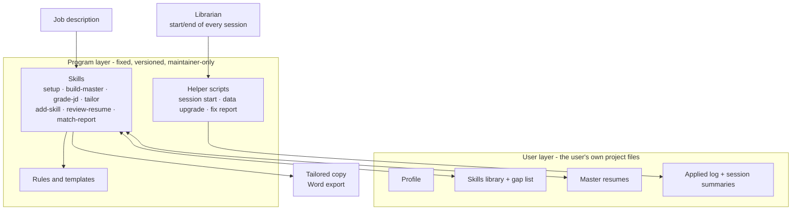

# Resume Kit — Honest Resume Builder (Claude Plugin)

**Status:** Pilot (pre-1.0, a small group of real job seekers) · **Stack:** Claude Cowork plugin (skills), Markdown templates, Python helper scripts, Word export · **Role:** Product owner and architect. I scoped the requirements with Claude, designed the workflow, directed Claude Code to build it, and ran every install and retest myself.

> Source is private during the pilot. All examples use a fictional person, "Jane Doe, Acme Corp".

## Problem
- Job seekers, especially non-technical ones, struggle to tailor a resume to each job description without overstating their skills.
- AI writing tools make overclaiming easy: a job ad mentions a skill, and the tool quietly adds it.
- Most tools give a match score with no reasons, so the user cannot tell what is a real gap.

## Solution
A guided plugin that runs inside Claude. A short setup interview builds a verified skills library, where every skill is confirmed in the user's own words along with its limits, plus a "never claim" gap list. From those it builds one master resume per role family. For each job description it then:
- grades the job through two lenses, a recruiter's and an engineer's
- checks the hard requirements first
- names the real gaps
- flags any honesty risk
- builds a tailored copy, with a plain-English explanation of why the user fits

## Architecture

- **Two layers:** program rules cannot be edited by the user, and user data never ships with the program.
- **Librarian:** runs at the start and end of every chat. It checks the version, upgrades the user's data files when the program changes, warns when a chat gets too long, and saves a session summary.
- **Fix Report:** when something breaks, the kit stops and writes a redacted report the user can send to the maintainer.

## Key design decisions
| Decision | Alternatives considered | Why |
|---|---|---|
| Never invent, infer or stretch a skill | Let AI suggest likely skills | The core promise is honesty. A job ad naming a skill is not evidence the user has it |
| User confirms each skill, one at a time | Parse the resume automatically | Confirmation in the user's own words captures limits that parsing misses |
| Narrow scope: five jobs only | Cover letters, interview prep, job search | A small, reliable v1 beats a broad, fragile one. Cover letters were deferred to after the pilot |
| Plugin with fixed program files | Copy-paste prompts | Versioned, testable, and upgradable without touching user data |
| Text master files as the source of truth | Word documents | Diffable and readable by Claude. Word copies are generated from them |

## Security and data handling
- **Privacy by design:** user data stays in the user's own project. The program ships no personal data, and all examples are fictional.
- **Redacted error reports:** names, emails, phones, addresses and employers are replaced with placeholders before any report leaves the user.
- **Change control:** every change has a numbered decision record, a version bump, a full install test and a retest before release.
- **Honesty gates:** a pre-send check compares each tailored copy against the verified library and blocks claims the library does not support.

## Testing and quality
- **Scripted install tests** on a clean machine, using the real app's labels.
- **Full end-to-end runs** with the fictional profile before each release, then a retest of every fix.
- **Pilot feedback loop:** issues from real users become numbered fixes in the next version.

## Code sample (illustrative, not production code)
```python
import re

PLACEHOLDERS = {"name": "[NAME]", "email": "[EMAIL]", "phone": "[PHONE]", "address": "[ADDRESS]"}

def build_redaction_map(profile: dict) -> dict[str, str]:
    """Map every sensitive value AND each part of it to a placeholder."""
    mapping = {}
    for field, placeholder in PLACEHOLDERS.items():
        value = profile.get(field, "").strip()
        if not value:
            continue
        mapping[value] = placeholder
        if field == "address":                      # also mask street, city, region, postal code
            for part in (p.strip() for p in value.split(",")):
                if len(re.sub(r"\W", "", part)) >= 3:
                    mapping[part] = placeholder
    return mapping

def redact(text: str, mapping: dict[str, str]) -> str:
    for value in sorted(mapping, key=len, reverse=True):  # longest first
        text = re.sub(re.escape(value), mapping[value], text, flags=re.IGNORECASE)
    return text
```

## Incidents

**1. The first run broke for new users**
- **Detection:** a scripted install test on a clean Windows machine, before the pilot started.
- **Impact:** the start guide named menu labels that did not match the real app. A user starting a chat on the wrong tab could not read the kit's files at all.
- **Root cause:** the instructions were written from the design, not from a real install.
- **Fix:** rewrote every step using the labels seen on a real install, and added a startup check that stops with a clear message if the kit's files cannot be read.
- **Lesson:** test the first five minutes the way a new user meets them.

**2. Partial address details could slip through error reports**
- **Detection:** reviewing Fix Report output during testing.
- **Impact:** a full address was masked, but its parts (city, region, postal code) could still appear on their own elsewhere in a report.
- **Root cause:** redaction matched only the complete value.
- **Fix:** redact the whole value and each meaningful part, longest first, with no false hits on short tokens like a street number.
- **Lesson:** PII rarely appears in the exact form you stored it.

## Outcomes and next steps
- Working end to end with real pilot users: setup, master resumes, job grading and tailored copies.
- Every release goes through a decision record, install test and retest.
- **Next:** finish the pilot, collect feedback, decide on cover letters, and release 1.0.

[← Back to the portfolio](../README.md)
