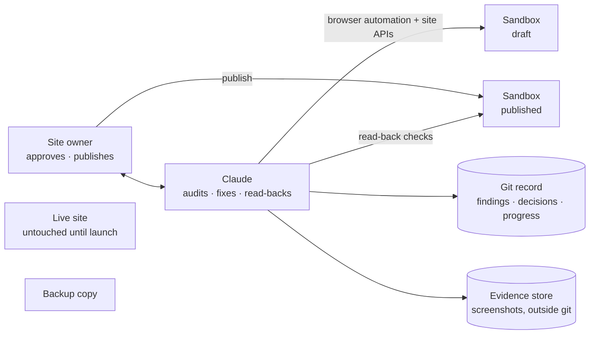

# Website QA & Rebuild — AI-Driven Quality Program for a Company Website

**Status:** Staging complete, launch-ready, waiting on the business's go-live decision · **Stack:** Wix (site platform and APIs), Claude with browser automation, PageSpeed Insights, Git for the decision and progress records · **Role:** QA lead and project manager. I designed the phased process, directed Claude to run audits and apply fixes, and kept every publish and business decision with the site owner.

> Built for my employer. The site, its content and its contacts are not shown. All details are generic.

## Problem
- The company's website had broken links, inconsistent design, slow mobile load times and a contact form whose messages were not reaching the right inbox.
- Changes had been made ad hoc on the live site, with no record of what changed or why.
- The live site had to keep running untouched while the new version was built.

## Solution
A phased QA program with three copies of the site:
- **Live:** the public site, never touched during the work.
- **Sandbox:** where every change is built and tested.
- **Backup:** a saved copy of the original setup.

Claude runs the audits and applies approved fixes on the Sandbox. The site owner reviews and publishes. After every publish, Claude reads back the published pages to verify the result.

## Architecture

- **Phases:** baseline audit → link audit → UX and performance review (desktop and phone) → approved fix list → versioned fix batches → launch gate.
- **Records:** every finding gets an ID, every owner decision a decision number, and every batch a version, with a pass or fail result.

## Key design decisions
| Decision | Alternatives considered | Why |
|---|---|---|
| Build on a Sandbox copy, leave Live alone | Edit the live site | No risk to the public site, and a working fallback at all times |
| Owner publishes, Claude never does | Let the AI publish | Publishing is a business decision. The AI prepares, a human releases |
| Approved fix list, then small batches | One big redesign | Each batch is reviewable, testable and easy to undo |
| Read back every published page | Trust the editor preview | Preview and published output can differ; only the published page counts |
| Evidence outside the repo | Commit screenshots | Keeps the repo small and keeps images of client-facing content out of version control |

## Security and data handling
- **Least privilege:** Claude works in the Sandbox editor and APIs. Plan changes, domain changes and publishing stay with the owner.
- **Live site protected:** search indexing stays off on the build site until launch, and the live domain is not touched.
- **Respectful automation:** page checks are spaced out. When the platform rate-limits or shows a bot check, the automation waits; it never bypasses it.
- **Test data hygiene:** contact form tests use clearly labelled test entries, never a real customer's details.

## Testing and quality
- **Every fix batch:** saved on the Sandbox, previewed on desktop and phone, published by the owner, then read back live.
- **Launch gate checklist:** redirects for old addresses, a custom error page, a final site name, indexing switched on, an end-to-end contact form test with the owner, and a full final read-back.
- **Design standard:** a written type and spacing standard, applied site-wide and audited against.

## Code sample (illustrative, not production code)
```python
import time
import requests

def read_back(urls: list[str], expect_title: dict[str, str], gap_s: float = 1.0) -> list[str]:
    """Check published pages politely: spaced requests, back off on rate limits, never bypass."""
    failures = []
    for url in urls:
        for attempt in range(3):
            r = requests.get(url, timeout=20)
            if r.status_code == 429:               # rate-limited: wait, then retry
                time.sleep(gap_s * 10 * (attempt + 1))
                continue
            break
        if r.status_code != 200:
            failures.append(f"{url}: HTTP {r.status_code}")
        elif expect_title.get(url) and f"<title>{expect_title[url]}" not in r.text:
            failures.append(f"{url}: title mismatch")
        time.sleep(gap_s)                          # space every request
    return failures
```

## Incidents

**1. Contact form messages went to the wrong inbox**
- **Detection:** an end-to-end test submission during the baseline audit.
- **Impact:** customer enquiries reached a personal inbox instead of the company's shared one, so leads could be missed.
- **Root cause:** the form's notification setting pointed at the account owner's address only.
- **Fix:** added the company inbox as a recipient on both the Sandbox and Live sites, then confirmed with fresh test submissions that both inboxes received them.
- **Lesson:** test the whole journey, from the customer's click to a person's inbox, not just the form.

**2. An Editor left open published an old copy of the site**
- **Detection:** the read-back after a publish found the published pages did not match the saved changes.
- **Impact:** recent approved fixes were briefly replaced by an older version.
- **Root cause:** an Editor window opened earlier still held an old copy, and publishing from it overwrote newer work.
- **Fix:** republished from a freshly opened Editor and verified with a full read-back. It is now a standing rule: publish only from a freshly opened Editor, and close Claude's Editor tab after every save.
- **Lesson:** a successful publish is not proof of the right content. Verify by effect.

## Outcomes and next steps
- The broken links, contact routing and mobile layout issues found by the audits were fixed, and the phone version became much faster.
- Clean page addresses, page titles and descriptions throughout, and a consistent design standard.
- Every change is traceable to a finding, a decision and a version.
- **Next:** the owner's launch decision, then the launch checklist: plan upgrade, error page, domain, redirects, indexing on, and a final read-back.

[← Back to the portfolio](../README.md)
